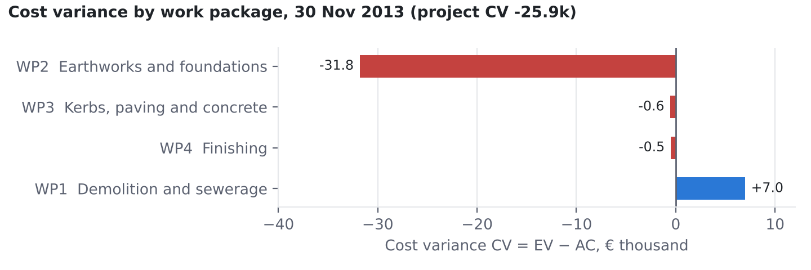

| Member | Roll no. | Role |
|---|---|---|
| Prashant Kumar | 24B0611 | Project Lead and Finance Modeller |
| Varun Chandak | 23B2466 | Data Lead |
| Sobhith R | 26M0617 | AI and Tool Developer |
| Arjun Andhare | 23B2419 | Validation Engineer |
| Shreyansh Singh | 26M0609 | Documentation and Reflection Lead |

> **Read this before editing.** The structure follows Section 7 of the course guidelines (six sections, 10–15 pages). Sections 1–4 and 6 were drafted with AI assistance (Claude) from what actually happened in the project — every number comes from a test run, the validation report or the AI usage log, and the source is named. **The team must read, check and rewrite them in its own words**; text in *[square brackets]* must be replaced. Section 5 is deliberately left empty: each member writes their own half page. The guidelines treat unverified AI output submitted as the team's own analysis as misconduct (Section 8.1), so do not submit this draft unedited. Delete this box before submission.

# 1. Subject learnings

This section records what we now understand about construction economics and finance that we did not understand, or understood only as formulas, before the project. Each point is tied to a number we produced and checked.

## 1.1 EVM separates questions that budget-vs-actual reporting mixes up

A conventional cost report compares actual cost (AC) with the budget planned to date (PV). An under-spend can mean efficiency, or simply that less work was done. Earned value (EV), the budgeted value of the work actually performed, separates the two questions: CV = EV − AC measures cost efficiency, and SV = EV − PV measures progress against plan.

Our synthetic benchmark (validation report, Part A) shows the trap. At 31-Jan-2026, AC was ₹137 lakh against PV of ₹146 lakh, so a budget-vs-actual reading says "₹9 lakh under budget". EV was only ₹128 lakh. The project was in fact both behind schedule (SV = −₹18 lakh) and over cost for the work done (CV = −₹9 lakh). The apparent saving was unfinished work.

## 1.2 Cumulative and period values are not interchangeable

All EVM status values are cumulative to the status date. Adding cumulative values double-counts. Treating one month's cost as cumulative understates AC. Site cost sheets often hold monthly figures, so the tool asks for cumulative AC and accepts period AC only in a separate, clearly named column (`ac_period`). The validation rejects a cumulative series that falls without an explanation. *[Team: add the moment this confused one of us, for example while preparing the benchmark.]*

## 1.3 Project progress is budget-weighted, not an average

In the benchmark at 28-Feb-2026 the four work packages were 100 %, 55 %, 5 % and 5 % complete. The simple average is 41.25 %, which gives EV = ₹165 lakh. The budget-weighted figure is 44 % and EV = ₹176 lakh, because the largest package (RCC superstructure, ₹160 lakh) is the one furthest along. The ₹11 lakh difference (6.3 %) is larger than the cost variance itself. We built the benchmark around this trap on purpose (validation report §4).

## 1.4 Physical progress is the hardest number, and the most important

Every EVM metric depends on "% complete", but the arithmetic is the easy part. Measuring progress honestly is not. While designing the file reader we learned that the "% Complete" field in MS Project is *duration* progress (time elapsed on the activity); physical progress is a separate field. Using duration progress as physical progress would make EV follow the calendar rather than the work. The smart reader therefore never maps a bare "% Complete" column automatically (AI log entry 9; `tests/test_data_validation.py`, `tests/test_smart_reader.py`). *[Team: confirm this against the MS Project documentation, as the log entry asks.]* A site sheet from our own team also stored progress as fractions (0.75), which a naive reader treats as 0.75 % (defect D7). The tool can enforce consistency. It cannot tell whether "55 % complete" is true. That remains a site-measurement question: agreed rules of credit per work type, such as steps for RCC work (shuttering, reinforcement, concreting).

## 1.5 SPI measures value, not time

SV is in rupees or euros, not days. SPI = EV / PV also tends to 1.00 as a project finishes, because both reach BAC. The real project in our manual check case shows this clearly. IJzertoren Memorial Square (DSLIB C2015-33) had a baseline finish of 20-Dec-2013 and actually finished on 28-Feb-2014, more than two months late. Yet its SPI on the final report is exactly 1.000. Schedule delay has to be judged from the programme and critical path; Earned Schedule (Lipke, 2003) is the usual EVM extension for this. Our dashboard therefore labels SPI as an *efficiency of earning value*, not a measure of delay, and draws the baseline-finish line on the S-curve so the user can see lateness directly.

## 1.6 A forecast is an assumption made explicit, and it can be badly wrong

We used to think of EAC as "the" forecast. The three index-based formulas are really three statements about the future:

- **A, BAC / CPI:** past cost efficiency continues.
- **B, AC + (BAC − EV) / (CPI × SPI):** schedule pressure will also cost money.
- **C, AC + (BAC − EV):** the past variance was a one-off.

For our demo project at 30-Sep-2026 they range from ₹1,245.5 lakh to ₹1,312.7 lakh. That spread is decision information in its own right.

Real data taught us more than the formulas did. Because the final cost of the DSLIB projects is known, we could check the forecasts themselves (Figure 1). In the manual check case, at about 50 % complete, method A over-forecast the final cost by 33.7 %, method B by 92.5 % and method C by 15.3 %. Most of the overspend happened early: CPI fell to 0.71 and then recovered to 0.98. The second real project, a Belgian apartment building (DSLIB C2014-05) cut at 50 % complete, gave the same ordering: A +7.0 %, B +32.5 %, C −1.5 % (`data/real/forecast_test/`, `tests/test_forecast_at_50pct.py`; the 50 % report is interpolated between two real reports and labelled as such). Two projects are not a study. Still, they showed us something a synthetic case cannot: a widely quoted finding from defence contracts, that cumulative CPI stabilises after about 20 % completion (Christensen and Heise, 1993), did not hold for these two small construction projects.

{width=86%}

## 1.7 TCPI turns a forecast into a feasibility test

TCPI to BAC is the cost efficiency the remaining work must achieve to finish within budget. In the manual check case at 31-Dec-2013, TCPI was 1.776 against a CPI achieved so far of 0.713. Every remaining euro of work would have needed to produce €1.78 of value, which is not realistic. The project did finish over budget, at €224,790 against €214,418. Once AC exceeds BAC with work still left, TCPI to BAC cannot be achieved at all: the original budget is gone. The dashboard reports "N/A" once all work is earned, rather than a misleading number.

## 1.8 Undefined is not zero

CPI with AC = 0 is undefined, not 0 and not infinity. Treating it as zero would make a project that has not started look catastrophically inefficient. The manual check case contains a subtler real example. On 30-Nov-2013 work package 4 (finishing) had earned €5,686 of value although none was yet planned (PV = 0), because the contractor started early. Its SPI is undefined, so its status is *Insufficient data* rather than a number. The dashboard keeps three states apart: *Not started* (nothing planned, earned or spent), *Insufficient data* (an index cannot be calculated) and a computed status.

## 1.9 The project total hides where the problem is

At 30-Nov-2013 the manual check case had CV = −€25,905 (CPI 0.755). The work-package view (Figure 2) shows that one package, earthworks and foundations, was €31,820 over cost (CPI 0.373). That is more than the whole project's variance, partly offset by demolition (+€6,986). A project manager looking only at the total would ask the wrong people the wrong questions. This is why the team asked for the combined CPI/SPI chart and the work-package and top-problem tables on the main screen.

{width=80%}

## 1.10 Why this matters financially

For a contractor, a falling CPI is a cash-flow and margin problem months before the final account. For a client or its consultant, EV is the defensible basis for interim payment certificates, because it pays for value earned rather than money spent. For a lender, comparing drawdowns (AC) with EV shows whether loan disbursements are buying progress. The same three numbers answer all three parties' questions, which is why EVM is worth the effort of honest progress measurement.

# 2. AI capability assessment

## 2.1 How AI was used

The team used one AI system, Claude (Anthropic), in an agentic session that could read the course documents, write and run code and tests, take browser screenshots and draft documents. The AI usage log records 37 significant interactions between 21 and 29 October 2026: 24 accepted, 11 modified and 2 rejected (`reports/ai_usage_log.csv`). *[Team: add any other AI use — e.g. ChatGPT for topic selection or charter drafting — to the log and to this paragraph. The log should be complete, not selective.]* The team chose **not** to call an AI service from inside the app. The "smart reader" that interprets uploaded files is rule-based and runs offline (AI log entry 28), so no project data leaves the user's computer.

## 2.2 Where AI accelerated the work

- **Structure and first versions.** The app was split into calculation, validation, smart-reader, analysis and interface modules within the first day, with guard conditions for every division (AC = 0, PV = 0, EV = BAC).
- **Tests at scale.** 164 automated tests by 29-Oct, including tests written from hand-calculated values before the code (test-driven development) and mutation tests that insert typical formula errors to prove the tests can fail.
- **Real data.** The AI located the DSLIB database (Ghent University) and extracted 78 construction projects. It then checked its own extraction by recomputing CPI and SPI for all 836 reporting periods and comparing with the values recorded by the project-control software (largest difference below 10⁻¹³; AI log entry 24).
- **Independent checks.** The AI produced an exact-fraction script and plain-formula Excel workbooks (73 formulas for Part A, 502 for Part B) that share no code with the dashboard.
- **Messy inputs.** The AI built detection of header rows, status dates above tables, fractions, "lakh/crore" text and totals rows, from real files the team supplied.
- **Documentation.** Tables in the validation report are generated from the comparison scripts, not typed by hand.

## 2.3 Where AI was wrong: specific examples

The course asks for specific incorrect formulas, wrong assumptions, fabricated data and faulty code. The examples below are all recorded in the AI usage log (No.) or the validation report defect list (D).

| Type | What the AI produced | How it was caught | Ref. |
|---|---|---|---|
| Wrong assumption about the request | Built a **new, separate app** when asked to change the team's existing app on GitHub | Team member noticed; the work was redone in the team repository | log 26 |
| Wrong application of a rule | A mock-up labelled a work package with CPI 0.86 as "Amber"; by the team's rule (below 0.90) it is Critical | Tests written from hand-calculated statuses | log 27 |
| Wrong number in prose | Summary gave CPI at 31-Dec-2013 as 0.714; correct is 111,728.57 / 156,594.45 = 0.71349 → **0.713** | Interface test against the on-screen value | log 34, D12 |
| Data precision error | Rounded % complete to 4 decimals in a test project, creating false variances up to €3.88 against the recorded values | Comparison with the project-control software's values | log 25 |
| Guessed tolerance | First real-data test used a €3 tolerance "because it seemed enough"; the observed difference was €3.79 | Test failed; bound derived properly: 0.005 % × BAC = €10.72 | log 35, D13 |
| Faulty test | Test for benchmark independence searched the text for "from src" and failed on a docstring, a false alarm | Reading the failure; rewritten to inspect actual import statements | log 10, D1 |
| Faulty code (state) | A project name typed for a rejected file was silently reused for the next valid file | Only a real-browser test found it; unit tests passed | log 13, D2 |
| Faulty code (version) | Styling targeted a page element that does not exist in Streamlit 1.66, so the panel had no card | Screenshot review | log 36, D14 |
| Wrong assumption about inputs | File reader assumed template-shaped files; the team's own site sheet failed (header on row 4, 0.75 read as 0.75 %) | Uploading the team's real sheet | log 29, D7 |
| Alarming message design | Supplied PV/EV columns were reported as "not needed" with a warning, which looked like an error to the user | Team member's upload and question | log 30, D9 |
| Self-reporting error | While drafting the log, the AI stated "28 validation tests"; the actual count was 36 | Re-running the tests | log 21 draft |

**Formulas.** We found **no incorrect EVM formula in the calculation engine**: every formula matched three independent calculations (paper, exact fractions, plain spreadsheet). That is a validated result, not an assumption. Mutation testing showed the tests would have caught the seven most common formula errors, for example EAC = BAC × CPI, or SV = PV − EV (validation report §12). The AI's numerical errors occurred in its *prose* (log 34) and in *data preparation* (log 25), not in the tested code. This is a useful distinction: numbers an AI writes in sentences are not checked by anything unless someone checks them.

**Fabricated data.** No data was fabricated, but the risk was real. When we asked for a file "at 50 % complete", no real report fell at exactly 50 %. The AI produced an *interpolated* report between two real ones and labelled it as such in every row and in the answer key (log 32). Had that label been dropped, the file would have been fabricated data presented as real. The synthetic demo and benchmark projects are labelled "SYNTHETIC" in the app, the data files and the reports.

*[Team: add errors you found yourselves — formulas you questioned, explanations that contradicted your textbook, places where you overruled the AI. These carry the most weight for marks (AI usage log: 15 %).]*

## 2.4 The pattern we observed

AI output was **most reliable** where it could be checked mechanically against an independent calculation: formulas, data extraction, file parsing with known totals. It was **least reliable** in three areas:

- **Understanding what the user meant.** Building a new app instead of changing ours was the costliest error of the project.
- **Behaviour across a user session.** State bugs and layout appeared only in a real browser.
- **Its own summaries of numbers.** The AI wrote 0.714 for 0.713 and "28 tests" for 36.

A green test run was also not proof on its own. The tests had to be shown capable of failing (mutation testing, 6/6 for the 29-Oct changes and 7/7 for the formulas). Some AI-written tests were themselves wrong (D1, D13).

## 2.5 What we would do differently

We would state the target precisely at the start ("change the app in repository X, deployed at Y") and ask the AI to restate the request before building. We would write the hand calculation first and the code second, as we did from the second week. We would treat every number the AI writes in prose as unverified until it appears in a test or a generated table.

# 3. Validation insights

## 3.1 Two benchmarks, three independent routes

The course asks for a manual calculation of all EVM indices for two reporting periods. We did this twice.

- **Part A (synthetic G+4 block).** Four work packages, ₹4 crore, with deliberate traps: cost without progress, and a budget-weighting trap. All 54 values per input mode matched; the three input modes gave 162 of 162 values within ₹0.01 and 10⁻⁹.
- **Part B (real project, the manual check case).** Four work packages, five monthly reports, final cost known. 90 of 90 values matched between the hand-calculation workbook and the dashboard, plus every work package's PV, EV, AC, CV, SV, CPI, SPI and status at every date.

For Part A, the paper working, an exact-fraction script and a plain-formula spreadsheet were made to agree with each other *before* any comparison with the dashboard. A disagreement among them would have pointed at the benchmark, not the tool.

## 3.2 Tolerances must be justified, not chosen

We compared at full precision with tolerances of one paisa or cent for money and 10⁻⁹ for indices. Rounding both sides before comparing can hide a real discrepancy. The real-data case taught us to *derive* tolerances. The manual check file rounds percentages to two decimals so that it can be worked with a calculator. The largest possible effect on PV or EV is therefore 0.005 % of BAC, about €10.72, and the observed difference from the recorded values was €3.79. A guessed tolerance of €3 had failed (D13). Input format, not only formulas, affects results: the same effect appeared as ₹0.40 in the synthetic demo data (D5) and €3.88 in the AI's 4-decimal test file (log 25).

## 3.3 Hard cases validate; easy cases do not

The benchmarks were built to include situations where a plausible formula gives a wrong answer:

- cost without progress (a procurement advance);
- a large package far ahead of small ones (weighting);
- value earned before any was planned (early start, SPI undefined);
- a period where nothing has started;
- the completion report, where TCPI is not applicable.

A benchmark with only "normal" periods would have passed an engine that averaged percentages or divided by zero.

## 3.4 Correct formulas do not guarantee good forecasts

This was the most important insight from real data. The dashboard's EAC values are *correct*: they equal the hand calculation to the cent. They were still *poor forecasts* until late in the manual check case (Figure 1), and method B was the worst in both real projects tested. Validation of a forecasting tool therefore has two levels. The first is "does it compute what the formula says?" (verified). The second is "is the formula a good predictor here?" (case-dependent). The first can be proved; the second can only be observed. This is why the dashboard shows all methods side by side, labels every EAC as an assumption-based forecast and never presents one as "the" answer.

## 3.5 Real files broke the tool more than formulas did

Every defect found after the first week (D7–D11, D14–D16) concerned *reading inputs or presenting results*, not calculating them. The team's own site sheet had its header on row 4, the status date above the table, fractions and a totals row. A team member's file carried its own PV and EV columns. A one-date file produced near-empty charts. The tool handles each of these now, and each has a test. The lesson for practice: a correct engine behind a fragile input screen is still a tool that gives wrong answers.

## 3.6 What validation could not show

- An edit typed into a cell of the manual-entry table could not be automated reliably in the browser and is checked by hand (open item).
- No test can show that the progress percentages in a real file are true.
- Two real projects are not enough to rank forecasting methods in general.

*[Validation Engineer: record how long the paper calculation took, any slip made on paper and how it was found. This shows why the tool helps and why the paper check is still needed.]*

# 4. Practical relevance

*[Bonus credit (Section 8.1): if possible, show the dashboard to a practising site engineer, contractor, consultant or bank engineer. Record their role (and name only with permission), the date, what they tried, and their answers to the questions below. Replace or extend this section with their feedback.]*

Suggested questions for the practitioner: (1) Would you use this for monthly reporting? Why or why not? (2) How do you measure physical progress today? (3) Which screen or number would you look at first? (4) What is missing before you could rely on it? (5) Would you trust the forecast, and which method would you use?

## 4.1 Who would use it

| User | What they would use it for | What it already supports |
|---|---|---|
| Contractor's planning / project-controls engineer | Monthly cost and progress report to management; finding the work packages that lose money | Upload of site sheets as they are; work-package status; top problem activities; commentary; Excel export |
| Client's project-management consultant | Checking a contractor's claimed progress against cost; basis for interim payment | EV from physical progress; cross-check of supplied PV/EV columns; validation with row numbers |
| Developer | Portfolio view of cost-to-complete and funding need | EAC/ETC by method; forecast overrun % |
| Lender's or bank's engineer | Whether loan drawdowns buy proportionate progress | AC vs EV over time; TCPI as a feasibility test |
| Site engineer | Little direct use; supplies the progress and cost data | Templates and the smart reader reduce reformatting |

## 4.2 What would need to change for real use

- **Integration.** Read progress from the scheduling tool (Primavera P6, MS Project) and cost from the accounting system, instead of manual uploads.
- **Change control.** Re-baselining, approved variations and change orders, and contingency and management reserve held outside the performance baseline.
- **Time forecasting.** Earned Schedule for completion-date forecasts; SPI alone cannot give one (Section 1.5).
- **Progress rules.** Agreed measurement rules per work type and evidence attached to each progress claim.
- **Governance.** Multi-user access, an audit trail of who changed which number, and approval of forecasts before they are reported.
- **Data storage.** Projects are currently held only for the browser session; exports are the only record.

The smart reader recognises common layouts, not every possible file, and the user must still check what it reports.

## 4.3 Would they use it?

Our judgement, to be tested with a practitioner: a planning engineer or consultant could use the dashboard *today* as a monthly check on an existing spreadsheet process, because it accepts their sheets as they are and explains its numbers. It would not replace a project-controls system, because of the gaps above. Its strongest feature for practice is not the formulas but the explanation: every figure can be traced to an input row and a hand calculation.

# 5. Individual reflections

*Each member writes their own half page (about 250 words) in the first person. Not written by AI. Suggested prompts: What did your role require in practice? What did you learn about EVM or construction finance that you did not know before? One moment when AI helped you, and one when it misled you or you corrected it (give the AI log number). What would you do differently?*

**Prashant Kumar (24B0611), Project Lead and Finance Modeller.** *[To be written by Prashant. Possible material from your own work: defining the screen layout the team wanted; noticing that the AI had built a separate app; your own data sheet and the PV/EV question; choosing the built-in reader over an online AI service.]*

&nbsp;

**Varun Chandak (23B2466), Data Lead.** *[To be written by Varun. Possible material: the data templates; the team's site sheet (header row, fractions, totals row); choosing and checking the real DSLIB projects; cumulative vs period data.]*

&nbsp;

**Sobhith R (26M0617), AI and Tool Developer.** *[To be written by Sobhith. Possible material: reviewing AI-generated code; the smart reader design; the Streamlit deployment; the browser-only defects.]*

&nbsp;

**Arjun Andhare (23B2419), Validation Engineer.** *[To be written by Arjun. Include your own paper re-calculation of both benchmarks (Part A and the manual check case), the time it took, and what the forecast check on real data showed you.]*

&nbsp;

**Shreyansh Singh (26M0609), Documentation and Reflection Lead.** *[To be written by Shreyansh. Possible material: keeping the AI usage log honest and complete; turning test outputs into the user manual and validation report; what the team would document differently next time.]*

&nbsp;

# 6. Ethics and limitations

## 6.1 Data reliability

EVM outputs inherit every weakness of the progress and cost data. A dashboard that shows an EAC to the euro can create false confidence: in the manual check case a correctly computed EAC was 93 % too high at mid-project (method B). The dashboard therefore labels forecasts as assumption-based, shows the spread between methods and states its assumptions on screen and in the user manual. Inputs are validated: negative costs, progress outside 0–100 % and duplicate dates are rejected with the row number. Falling cumulative values are flagged. Missing values are never treated as zero.

## 6.2 Over-reliance on AI

The defects in Section 2.3 show why AI output cannot be taken on trust, even when it looks finished and its tests pass. Our safeguards were:

- hand calculations prepared independently of the code;
- tests written before the code;
- mutation testing to prove the tests can fail;
- real-browser testing and screenshot review;
- generated, not typed, result tables.

The guidelines require every member to explain any formula or result without the tool (individual viva). The hand-calculation workbook for the manual check case exists for that purpose.

## 6.3 Accountability for decisions based on AI-generated numbers

Decisions based on these numbers belong to the professionals who make them: claims, payments, corrective action, reporting to a lender. The health labels (Warning below 1.00, Critical below 0.90, overrun above 0 % and 10 %) are adjustable screening rules chosen by the team, not industry standards. The commentary is generated by fixed rules and never claims a cause the data cannot show. It suggests what to investigate, not what went wrong. A wrong decision cannot be blamed on the tool, and still less on the AI that helped build it.

## 6.4 Confidentiality and data use

Real project cost data is commercially sensitive. The app runs locally and sends no uploaded data anywhere. The team deliberately rejected an AI-service file reader for this reason (log 28). The real data used in this project comes from the public DSLIB research database and is cited (Batselier and Vanhoucke, 2015). Synthetic and interpolated data are labelled everywhere they appear. *[Team: state whether any member's own site data was used, whether permission was obtained, and confirm that no confidential data was pasted into an AI tool.]*

## 6.5 Limitations that remain

- One baseline per dataset and no re-baselining.
- One currency per dataset.
- SPI does not measure critical-path delay.
- Forecasts are only as good as their assumptions.
- Session data is not saved.
- The smart reader handles common layouts only.
- The manual-table cell edit is checked by hand.

The full list is in `documentation/assumptions_and_limitations.md` and validation report §13.

## 6.6 Disclosure

The tool, the tests and drafts of every report were developed with substantial AI assistance, disclosed in the AI usage log. The team reviewed and verified the outputs as recorded there and in the validation report sign-off. *[Team: confirm before submission.]*

# References

Batselier, J. and Vanhoucke, M. (2015). Construction and evaluation framework for a real-life project database. *International Journal of Project Management*, 33(3), 697–710.

Christensen, D. S. and Heise, S. R. (1993). Cost performance index stability. *National Contract Management Journal*, 25(1), 7–15.

Fleming, Q. W. and Koppelman, J. M. (2010). *Earned Value Project Management* (4th ed.). Project Management Institute.

Lipke, W. (2003). Schedule is different. *The Measurable News*, March 2003, 31–34.

Project Management Institute (2019). *The Standard for Earned Value Management*. PMI.

*[Team: check each reference against the library copy before submission and add the course textbook.]*
