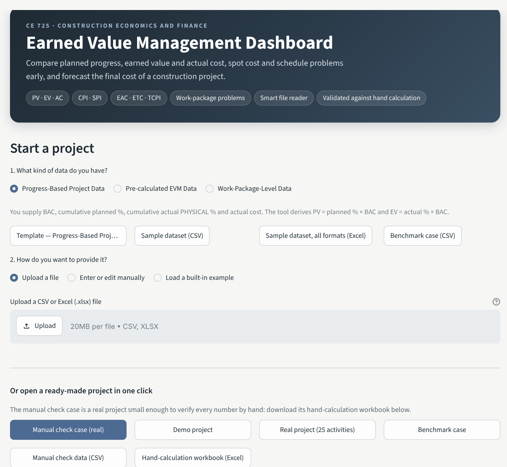
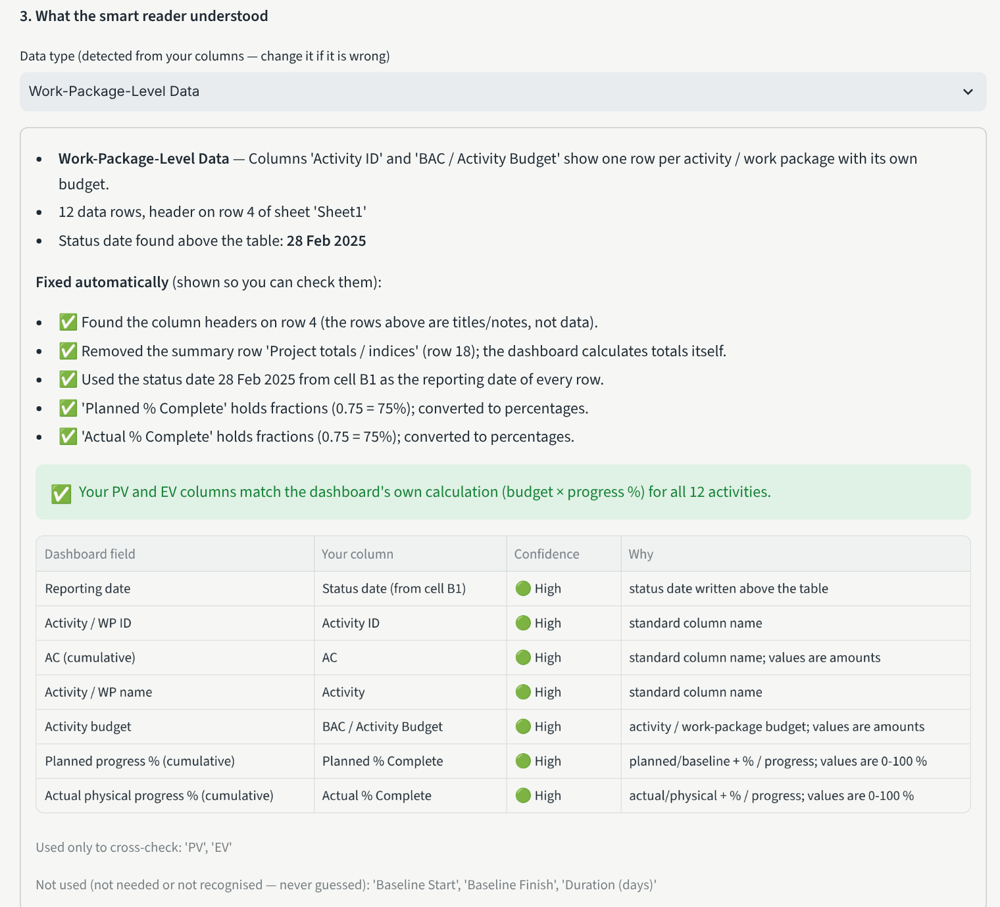
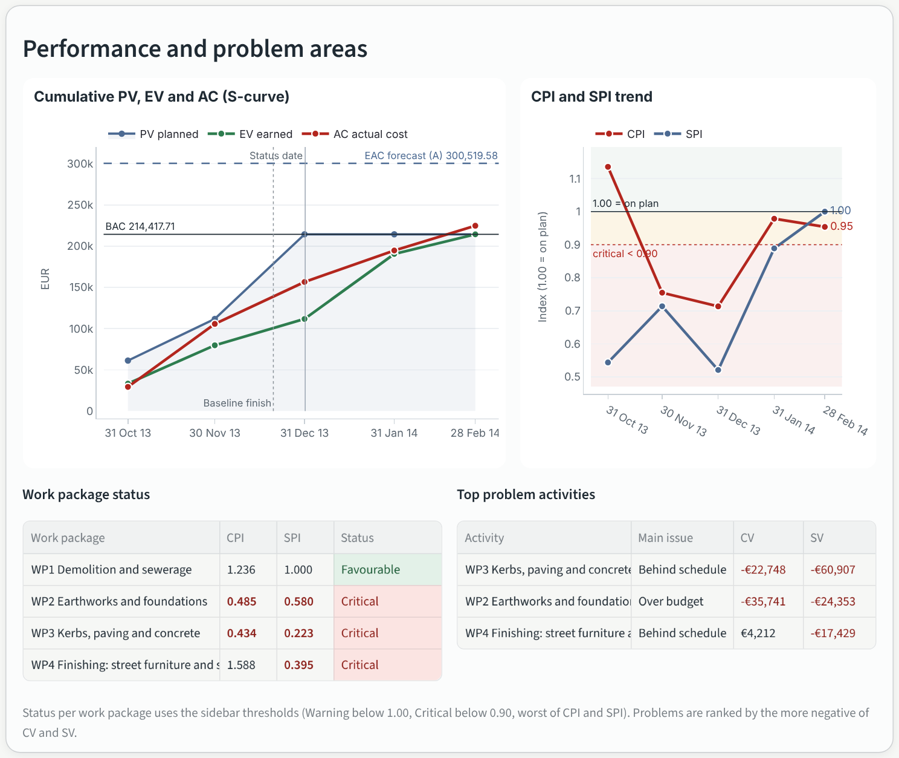

# 1. Purpose and intended users

The EVM Dashboard tells a project team, at each status date, whether a construction project is earning the value it planned to and at what cost, which work packages cause the problem, and what the final cost is likely to be under clearly stated assumptions. It is intended for project managers, construction managers, project-controls engineers, contractors, clients and quantity surveyors. It supports judgement; it does not replace it.

# 2. Starting the tool

Online: open the team's Streamlit link. Locally (Python 3.10+, tested on 3.13):

```bash
python -m pip install -r requirements.txt
streamlit run app.py
```

The app opens on the **home screen** (Figure 1). Nothing is analysed until you start a project in one of three ways: **upload a file**, **enter data manually**, or **open a ready-made project**. All calculations run on the machine running the app; no internet or AI service is used.

{width=50%}

# 3. Ready-made projects

| Button | What it is | Use it to |
|---|---|---|
| **Manual check case (real)** | Real project (DSLIB C2015-33, Belgium 2013–14): 12 activities grouped into 4 work packages, 5 month-end reports, budget €214,418; finished 2 months late and 4.8 % over budget | Check every number by hand with the **hand-calculation workbook** (download on the home screen) and demonstrate every feature |
| Demo project | Synthetic G+7 building, 6 work packages, 9 months | Practise |
| Real project (25 activities) | DSLIB C2014-05 apartment building, 13 reports | Larger real case |
| Benchmark case | Synthetic G+4 block, 4 work packages, 2 months | The original paper benchmark |

# 4. Your own data

**Step 1 – kind of data.** *Progress-based* (BAC, cumulative planned %, actual physical %, AC → the tool derives PV and EV), *Pre-calculated* (cumulative PV, EV, AC used as supplied) or *Work-package* (budget, planned %, actual %, cumulative AC for each package at each date → budget-weighted PV and EV). Templates and samples download under Step 1; blank templates are also in `templates/`.

**Step 2 – upload.** Upload the CSV or Excel file *as it is*. The **smart reader** (rule-based, offline) shows what it understood before anything is calculated (Figure 2):

- the **data type** detected from your columns (change it if wrong), the **header row** even when titles sit above the table, and a **status date** written above the table, which becomes the reporting date of every row;
- **fixes made automatically**, each listed so you can check it: total rows removed, fractions (0.75) converted to 75 %, "137 lakh" / "4 crore" converted to full amounts;
- **column matches** with a confidence and reason. A column is matched only if both its header and its values fit; unknown columns are never guessed; MS Project's bare "% Complete" (duration-based) is not used as physical progress;
- if your file has its **own PV/EV columns**, they are cross-checked row by row against budget × progress %;
- **missing data** (often actual cost): type the values in the table shown, or download your file with the column added, fill it and upload again.

{width=55%}

**Step 3 – settings and validation.** Enter the project name, type, currency, baseline dates and reporting frequency. The validation result lists blocking errors and warnings with the **row number of your original spreadsheet** and how to fix each one. If anything blocks, there is no *Open dashboard* button. *Enter or edit manually* gives an editable table with the same checks.

**Input rules.** Values are **cumulative** to the status date (if you only have monthly costs, use `ac_period`). Actual progress is **physical** (share of budgeted scope done), not time elapsed. A blank is missing, not zero. In work-package data every package appears at every date with a constant budget.

# 5. The dashboard

The **top bar** is always visible: reporting date, forecasting method (A–D) and **← Home** to start another project. The **sidebar** holds display settings only: money unit (full, lakh, crore, million — display only) and the health thresholds. The **banner** shows the overall health and the key figures (CPI, SPI, % complete, EAC).

{width=62%}

| Measure | Meaning | Good sign |
|---|---|---|
| PV / EV / AC | Budgeted value scheduled / budgeted value earned / cost actually spent (cumulative) | — |
| CV = EV − AC | Cost gain (+) or loss (−) on the work done | ≥ 0 |
| SV = EV − PV | Value of work ahead (+) or behind (−) plan — money, not days | ≥ 0 |
| CPI = EV / AC | Value earned per rupee (euro) spent | ≥ 1.00 |
| SPI = EV / PV | Rate of earning value versus plan | ≥ 1.00 |
| EAC, ETC, VAC | Forecast final cost; cost still to spend; budget minus forecast | VAC ≥ 0 |
| TCPI to BAC | Efficiency the remaining work needs to finish within BAC | close to CPI |

**Undefined** = cannot be calculated (e.g. CPI when AC = 0; the ⓘ tooltip says why). **N/A** = does not apply (e.g. TCPI once all work is earned). Neither is ever shown as zero.

**Health.** Defaults: CPI or SPI below 1.00 = Warning, below 0.90 = Critical; forecast overrun above 0 % = Warning, above 10 % = Critical. Overall = Critical if any indicator is critical, *Insufficient data* if any cannot be calculated, otherwise the worst of the rest. These are adjustable screening rules, not industry standards.

**Performance and problem areas** (Figure 4): the S-curve (PV, EV, AC with BAC, forecast EAC, status date and baseline finish) beside one combined CPI and SPI chart over red/amber/green zones; then, for work-package data, the **status of each work package** (worst of its CPI and SPI; *Not started* when nothing is planned, earned or spent) and the **top problem activities**, ranked by the more negative of CV and SV. With a single reporting date the charts say so instead of drawing an empty trend.

{width=62%}

**Other tabs.** *Trends*: S-curve, CPI/SPI, planned vs actual progress, budget vs forecast, variance by work package, period table. *Forecasts*: methods A–D side by side, EAC over time, and the independent estimate for method D. *Commentary*: plain-English text generated by fixed rules (facts, change since last report, forecast, suggested investigations, caveats); it never claims a cause the data cannot show; download as Markdown. *Data*: exports (results CSV, inputs CSV, Excel workbook with all results and validation messages) and loading a different project.

| Method | Formula | Use when |
|---|---|---|
| A | EAC = BAC / CPI | past cost efficiency is expected to continue |
| B | EAC = AC + (BAC − EV) / (CPI × SPI) | recovering the schedule will cost extra (usually most pessimistic) |
| C | EAC = AC + (BAC − EV) | the past variance was a one-off (optimistic) |
| D | EAC = AC + your ETC | the team re-estimated the remaining work bottom-up (enter it in the Forecasts tab) |

# 6. Checking the tool by hand (manual check case)

Open **Manual check case (real)** and download the **hand-calculation workbook**. Pick a reporting date in the top bar and compare each figure with the same row of the workbook's *Project calculation* sheet; every cell is a visible Excel formula. At 31 Dec 2013, for example: BAC €214,417.71, PV €214,417.71, EV €111,728.57, AC €156,594.45, CPI 0.713, SPI 0.521, EAC (A) €300,519.58. The *Forecast check* sheet compares each forecast with the real final cost (€224,789.67) and the *Feature tour* sheet lists which feature to show at which date.

# 7. Troubleshooting

| Message | What to do |
|---|---|
| Required column … is not mapped / file does not contain … | Map it under *Check or change the column mapping*, add the column, or type the values in the table shown. |
| … is not a number / outside 0–100 % | Remove text from numeric cells; progress must be 0–100 %. |
| Duplicate reporting date | One row per date (per work package in work-package data). |
| Work package(s) … have no record for … | Repeat the unchanged cumulative values for that package and date. |
| Cumulative … decreases (warning) | Correct it, or explain it (re-measurement, credit note) in the notes column. |
| Only one reporting date in this data | Upload more reporting periods to see trends; snapshot values are still correct. |
| Edits disappeared | Session state is not saved; export the workbook before closing. |

# 8. Assumptions and limitations

Forecasts hold only under their stated assumptions. SPI is a budget-value measure: it does not show critical-path delay and tends to 1.00 at completion even for late projects. One baseline and one currency per dataset; no re-baselining. The smart reader recognises common layouts, not every possible file; always check what it reports. The manual check case rounds percentages to 2 decimals (PV/EV within €4 of the recorded values). Full list: `documentation/assumptions_and_limitations.md`.
