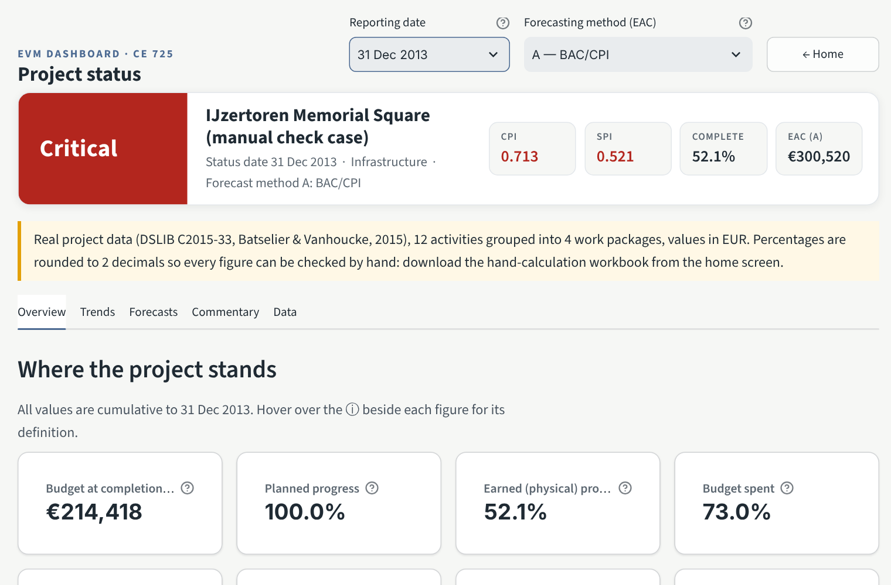
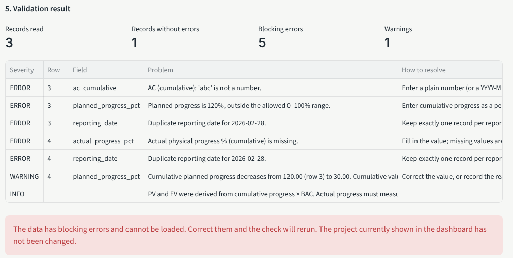
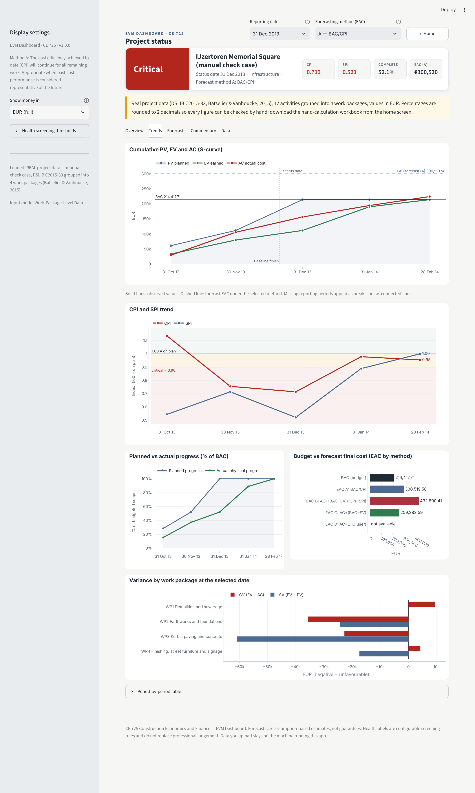

# 1. Purpose and intended users

The EVM Dashboard tells a project team, at each monthly (or weekly) status date, whether a construction project is earning the value it planned to and at what cost, and what the final cost is likely to be under clearly stated assumptions. It is intended for project managers, construction managers, project-controls engineers, contractors, clients/owners and quantity surveyors. It supports judgement; it does not replace it.

# 2. System requirements and launch

- Python 3.10 or later (tested on 3.13), and a modern browser.
- Install once, then launch:

```bash
cd evm_dashboard
python -m pip install -r requirements.txt
streamlit run app.py
```

The dashboard opens at `http://localhost:8501` on a **home screen**. Upload a file, enter data manually, or open an example project (demo, real DSLIB project or benchmark case) in one click; the analysis opens once a project is loaded. Use **Home** in the sidebar to start another project. No internet connection is needed for any calculation.

# 3. Screen layout

{width=66%}

- **Signboard** (top): overall health label, project, status date and forecast method.
- **Sidebar**: forecast method (A–D), money display unit (full, lakh, crore, million — display only), reporting date to view, and health thresholds.
- **Tabs**: Overview, Trends, Forecasts, Commentary, Data.

# 4. Setting up a project — the Data tab

**Step 1 — choose the kind of data you have.**

| Mode | You supply | The tool derives |
|---|---|---|
| Progress-Based Project Data | BAC, cumulative planned %, cumulative actual **physical** %, AC | PV = planned % × BAC; EV = actual % × BAC |
| Pre-calculated EVM Data | cumulative PV, EV, AC (e.g. exported from scheduling software) | nothing — supplied values are used as-is |
| Work-Package-Level Data | budget, planned %, actual %, cumulative AC per work package per date | budget-weighted PV and EV, summed AC |

Download the **template** for your mode (or a **sample dataset**) from the buttons under Step 1. Blank templates are also in `templates/`.

**Step 2 — provide the data.**

*Upload a file* (CSV or .xlsx; choose the worksheet for Excel). The tool shows a preview, suggests a **column mapping** from your headers (check it — unmapped columns are ignored, never guessed), asks for **project settings** (name, type, currency, BAC if not in the file, baseline dates, reporting frequency, date format), then shows the **validation result**: records read, records without errors, blocking errors, warnings, and a table giving the row, field, problem and how to fix it. If there are blocking errors there is no load button and the project already shown is not changed. If validation passes, tick *Replace the project currently shown* and press **Load into dashboard**.

{width=78%}

*Enter or edit manually* — an editable table with only the columns your mode needs (`*` = required). Add rows with the **+** control. *Reload from current project* edits the loaded data; *Start a new blank table* (tick the confirmation first) clears it. The same validation rules as uploads apply, and nothing reaches the dashboard until you load it.

*Load a built-in example* — the demonstration project or the two-period benchmark case used for validation.

**Exports** (top of the Data tab): Results (CSV), Inputs (CSV) and a Workbook (Excel) containing project settings, validated inputs, reporting periods, all results with status notes, work-package detail and validation messages.

# 5. Input rules that matter

- **Cumulative means to-date totals.** Never add cumulative values; if you only have monthly costs, use the `ac_period` column and the tool will total them.
- **Actual progress is physical**: the share of budgeted scope completed (quantities installed, milestones achieved). Time elapsed and MS Project's "% Complete" (a duration measure) are not physical progress.
- **Blank is missing, not zero.** A missing required value blocks loading. An AC of genuinely zero is allowed but makes CPI undefined.
- **Percentages are 0–100.** 0.45 means 0.45%, not 45% (the tool warns if all values look like fractions).
- **Work-package data:** every work package at every date; budgets constant; use a zero-budget package for unallocated costs.

# 6. Reading the results

| Measure | Meaning | Good sign |
|---|---|---|
| PV / EV / AC | Budgeted value scheduled / budgeted value earned / cost actually spent (cumulative) | — |
| CV = EV − AC | Cost gain (+) or loss (−) on the work done | ≥ 0 |
| SV = EV − PV | Value of work ahead (+) or behind (−) plan — **money, not days** | ≥ 0 |
| CPI = EV/AC | Value earned per rupee spent | ≥ 1.00 |
| SPI = EV/PV | Rate of earning value versus plan | ≥ 1.00 |
| EAC, ETC, VAC | Forecast final cost, cost still to spend, budget minus forecast | VAC ≥ 0 |
| TCPI to BAC | Efficiency the remaining work needs to finish within BAC | close to CPI |

**Undefined** means the value cannot be calculated (e.g. CPI when AC = 0) and the reason is in the ⓘ tooltip; **N/A** means the measure does not apply (e.g. TCPI once all work is earned); **⚠** means a value is shown but should be reviewed. None of these is ever shown as zero.

**Health signboard.** Defaults: CPI or SPI below 1.00 = Warning, below 0.90 = Critical; forecast overrun above 0% = Warning, above 10% = Critical. The overall label is Critical if any indicator is critical, *Insufficient data* if any indicator cannot be calculated, otherwise the worst of the rest. These are adjustable screening rules, not industry standards.

# 7. Forecasting methods (Forecasts tab)

| Method | Formula | Use when |
|---|---|---|
| A | EAC = BAC / CPI | past cost efficiency is expected to continue |
| B | EAC = AC + (BAC − EV)/(CPI × SPI) | recovering the schedule is expected to cost extra (usually the most pessimistic) |
| C | EAC = AC + (BAC − EV) | the past variance was a one-off and its cause has been removed (optimistic) |
| D | EAC = AC + your ETC | the team has re-estimated the remaining work bottom-up |

The Forecasts tab compares all four side by side, charts BAC against each EAC and shows how EAC has moved over time. For method D, enter the independent ETC for the selected date and press **Apply estimate**; it is labelled user-entered in exports and lasts for the session.

{width=62%}

# 8. Charts (Trends tab)

Cumulative PV/EV/AC with BAC and the forecast EAC (dashed); one combined CPI and SPI trend chart with the 1.00 reference and critical line; planned vs actual progress; budget vs forecast final cost; and, for work-package data, CV and SV by work package. Solid lines are observed data, dashed lines are forecasts, and a missing reporting period appears as a break rather than a joined line.

# 9. Commentary tab

Plain-English text generated by fixed rules from the numbers: observed facts, change since the previous report, the forecast and its assumption, suggested investigations, and caveats. It never states a cause the data cannot show (it will say cost efficiency is unfavourable, not that labour productivity fell). Notes you entered for the period are quoted and marked as unverified. Download it as Markdown for a monthly report.

# 10. Common messages and troubleshooting

| Message | What to do |
|---|---|
| Required column '…' is not mapped | Map it in Step 3 or add the column from the template. |
| '…' is not a number | Remove text from the numeric cell; plain numbers, separators and ₹ are fine. |
| outside the allowed 0–100% range | Progress must be a percentage of scope between 0 and 100. |
| Duplicate reporting date | Keep one row per date (per work package in WP mode). |
| Work package(s) … have no record for … | Repeat the unchanged cumulative values for that WP and date. |
| Cumulative … decreases (warning) | Correct it, or explain it (re-measurement, credit note) in the notes column. |
| BAC in the file differs from settings | Make them equal, or clear the settings BAC. |
| Missing monthly period (warning) | Add the period or set the reporting frequency to Irregular. |
| App will not start | Check `python -m pip install -r requirements.txt` completed; run from the `evm_dashboard` folder. |
| Edits disappeared | Session state is not saved; export the workbook before closing. |

# 11. Assumptions and limitations (summary)

Forecasts hold only under their stated assumptions. SPI is a budget-value measure and does not show critical-path delay. One baseline and one currency per dataset. Rounded percentage inputs lose precision. All bundled data is synthetic. The full list is in `documentation/assumptions_and_limitations.md`.

### Performance and problem areas (Overview tab)

One panel shows the S-curve beside the combined CPI and SPI trend, then, for work-package data:

- **Work package status**: CPI, SPI and a status for each work package at the selected date, using the sidebar thresholds (worst of CPI and SPI; "Not started" when nothing is planned, earned or spent).
- **Top problem activities**: the five work packages with the largest shortfall, ranked by the more negative of CV and SV, with the main issue (over budget or behind schedule).

For project-level data the panel shows the two charts and explains that the tables need work-package data.

### Uploading your own file: the smart reader

Upload the file as it is; it does not need to match the template. The smart reader (rule-based, works offline, no AI service) then shows **what it understood** before anything is calculated:

- **Data type** detected from your columns (you can change it).
- **Header row** found even when titles or notes sit above the table; a **status date** written above the table (e.g. "Status date: 28-Feb-2025") becomes the reporting date of every row.
- **Fixed automatically**, each listed so you can check it: total/summary rows removed, percentages stored as fractions (0.75) converted to 75 %, amounts written as "137 lakh" or "4 crore" converted.
- **Column matches** with a confidence (High / Medium / Low) and the reason. A column is matched only when both its header and its values fit; unknown columns are listed as not used and are never guessed. A bare "% Complete" (MS Project, duration-based) is not used as physical progress.
- **Your own PV / EV columns**: in progress and work-package data the dashboard calculates PV = budget × planned % and EV = budget × actual %. If your file also has PV or EV columns, they are compared row by row: a green message confirms they match; otherwise each differing activity is listed with both values.
- **Missing data**: if a required column is absent (often actual cost), type the values in the table shown, or download your file with the column added, fill it in Excel and upload it again.

Then check the project settings and the validation result, and open the dashboard. Validation messages give the row number of your original spreadsheet.
